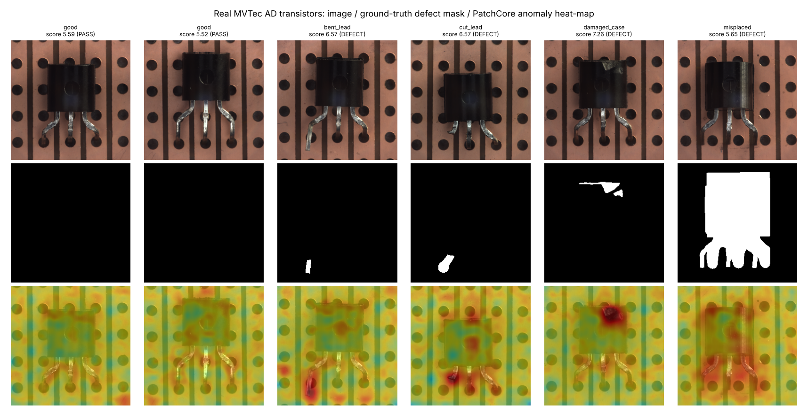

# Computer Vision-Based Industrial Quality Control & Defect Detection System
### Semiconductor device (IC package) inspection with YOLO11, U-Net, FastAPI and Streamlit

An AI-powered quality inspection system that analyses camera images of semiconductor devices on a conveyor. It works in four steps:
1. Detects every IC package with **YOLO11**.
2. Segments its defects with **YOLO11-seg** or **U-Net**.
3. Measures each defect in millimetres.
4. Decides whether the device should **PASS**, go to **REWORK**, or be **SCRAPPED**.

Results are shown on a **Streamlit** dashboard, served by a **FastAPI** backend and stored in **SQLite**.

> **Dataset notice:** the main training and test images are **synthetic**, generated by `src/qc/synth.py` with exact defect masks. The approach is also validated on **real photographs** from the public **MVTec AD** dataset (*transistor* category, 4 real defect types) — see *Real images* under Results.

**Author:** Balasudhan R (RA2411003012164)

**Live demo:** https://semiconductor-qc.vercel.app (trained models served as ONNX by FastAPI on Vercel, see `deploy/vercel/`). Tabs: upload and inspect, **Real transistor** (MVTec photos), **Live camera** (point a phone or webcam at a part for continuous inspection), conveyor simulation, analytics.


---

## How it works

```
Camera / image ──► OpenCV ──► YOLO11n detector ──► one box per IC device
                                   │
                                   ▼  square crop of each device (256 × 256)
                   YOLO11n-seg  or  U-Net ──► pixel mask for every defect
                                   │
                                   ▼  pixels → mm (camera calibration 12 px/mm)
                   area (mm²) and length (mm) of each defect
                                   │
                                   ▼  configs/quality_rules.yaml
                   PASS / REWORK / SCRAP per defect → worst one = device decision
                                   │
              FastAPI backend ─ Streamlit dashboard ─ SQLite database
```

| Defect | Example cause | Rule (editable) |
|---|---|---|
| **crack** | thermal / mechanical stress | any → SCRAP |
| **missing_pin** | lead-frame / trim-form damage | any → SCRAP |
| **chip** | handling impact | < 0.5 mm² PASS, else SCRAP |
| **scratch** | handling, pick-and-place | < 1.5 mm PASS, < 4 mm REWORK (buff/re-mark), else SCRAP |
| **contamination** | flux, residue, particles | < 0.5 mm² PASS, < 3 mm² REWORK (clean), else SCRAP |

## Results

<!-- RESULTS:START -->
Measured on the held-out **test split** (150 camera frames, 307 devices), CPU only. Generated by `python run_project.py evaluate`.

**Device detection (YOLO11n):** precision 1.000, recall 1.000, mAP50 0.995, mAP50-95 0.995

**End-to-end quality decision (PASS / REWORK / SCRAP):**

| Pipeline (detector + segmenter) | Decision accuracy | Decision macro F1 | Scrap escapes (SCRAP→PASS) | False scrap (PASS→SCRAP) | Missed devices | Latency / frame (CPU) |
|---|---|---|---|---|---|---|
| YOLO11n + YOLO11n-seg | 0.951 | 0.940 | 1.7 % | 0.8 % | 0 / 307 | 159 ms |
| YOLO11n + U-Net | 0.827 | 0.818 | 9.2 % | 12.1 % | 0 / 307 | 351 ms |

**Defect segmentation (pixel IoU / Dice on test crops):**

| Defect | YOLO11n-seg IoU | YOLO11n-seg Dice | U-Net IoU | U-Net Dice |
|---|---|---|---|---|
| crack | 0.734 | 0.847 | 0.606 | 0.755 |
| scratch | 0.509 | 0.675 | 0.475 | 0.644 |
| contamination | 0.911 | 0.953 | 0.892 | 0.943 |
| chip | 0.786 | 0.880 | 0.367 | 0.537 |
| missing_pin | 0.458 | 0.629 | 0.092 | 0.168 |
| **mean** | **0.680** | **0.797** | **0.486** | **0.609** |

**Second training stage** (`python run_project.py finetune-yoloseg`: warm start, scratch / missing-pin oversampling, cosine LR; adopted on validation macro F1). Same test split:

| Metric | Stage 1 (25 epochs from COCO) | Stage 2 (+ fine-tuning) |
|---|---|---|
| Validation decision macro F1 (adoption criterion) | 0.847 | **0.882** |
| Test decision accuracy | 0.886 | **0.951** |
| Test decision macro F1 | 0.877 | **0.940** |
| Scrap escapes (SCRAP→PASS) | 5.0 % | **1.7 %** |
| False scrap (PASS→SCRAP) | 9.1 % | **0.8 %** |
| Mask mAP50 (test crops) | 0.678 | **0.737** |
| Mean pixel IoU | 0.610 | **0.680** |
| scratch: pixel IoU | 0.469 | **0.509** |
| scratch: type recall / precision | 0.707 / 1.000 | **0.853 / 1.000** |
| missing_pin: pixel IoU | 0.166 | **0.458** |
| missing_pin: type recall / precision | 0.842 / 0.372 | **0.895 / 0.895** |
| Web demo (ONNX) test decision accuracy | 0.879 | **0.961** |

**Selected pipeline: YOLO11n + YOLO11n-seg** — YOLO11n-seg gives the highest end-to-end decision macro F1 (0.9401, accuracy 0.9511) vs U-Net (0.8178).


<!-- RESULTS:END -->

<!-- REAL:START -->
### Real images — MVTec AD *transistor* (real photographs, 4 real defect types)

| Stage | Metric | Value |
|---|---|---|
| PatchCore anomaly detection (no defect labels) | image AUROC, all 100 test images | 0.948 |
| | pixel AUROC (localisation) | 0.842 |
| | held-out accuracy / defect recall / false-reject rate | 85.0 % / 83.3 % / 13.9 % |
| Upgrade: score fusion (PatchCore OR YOLO11-seg) | PASS-REWORK-SCRAP acc. (95 % CI) / false-reject rate | **81.7 %** (71.7 % – 91.7 %) / 8.3 % |
| Upgrade: defect-type classifier (YOLO11s-cls, crop) | defect-type acc. / PASS-REWORK-SCRAP acc. (95 % CI) | 82.5 % / **86.7 %** (76.7 % – 95.0 %) |
| YOLO11n-seg, pretrained on our synthetic IC data (5-fold CV) | mask mAP50 / defect-type acc. / PASS-REWORK-SCRAP acc. | 0.414 / 37.5 % / 73.3 % |
| YOLO11n-seg, pretrained on COCO (generic) (5-fold CV) | mask mAP50 / defect-type acc. / PASS-REWORK-SCRAP acc. | 0.590 / 70.0 % / 76.7 % |



Reproduce: put the MVTec `transistor` folder (or archive) in `dataset/real/`, then `python run_project.py real-eval`. Details: report Section 12.
<!-- REAL:END -->

Full write-up: [`report/Project_Report.md`](report/Project_Report.md).

## Installation (Windows)

1. Install **Python 3.10–3.12** from python.org and tick *Add Python to PATH*.
2. Install **Git**.
3. In PowerShell, run:

```powershell
git clone https://github.com/BALASUDHAN1807/WaferSense-AI.git
cd WaferSense-AI
python -m venv venv
.\venv\Scripts\activate
pip install -r requirements.txt
```

If activation is blocked, run `Set-ExecutionPolicy -Scope CurrentUser RemoteSigned`, then activate again. On macOS/Linux, activate with `source venv/bin/activate`.

## Run it

The trained models are included in `models/`, so you can start the system straight away:

```powershell
python run_project.py serve
```

This starts the API at http://127.0.0.1:8000 (interactive docs at `/docs`) and the dashboard at http://localhost:8501.

| Command | What it does |
|---|---|
| `python run_project.py inspect dataset\samples\sample_00.png` | Inspect one image, print the decisions, save an annotated image |
| `python run_project.py camera --source 0` | Live inspection from webcam 0 (press **q** to quit) |
| `python run_project.py camera --make-demo-video` then `python run_project.py camera --source results\conveyor_demo.mp4` | Run on a demo conveyor video |
| `python run_project.py api` | FastAPI backend only |
| `python run_project.py dashboard` | Streamlit dashboard only (runs the models itself if the API is off) |
| `python run_project.py test` | pytest suite |

### Re-create everything from scratch

| Command | What it does | Time on a laptop CPU |
|---|---|---|
| `python run_project.py generate` | 750 synthetic frames, ~1,460 devices, labels and masks | ~1 min |
| `python run_project.py validate` / `eda` | Dataset checks, statistics and graphs | ~1 min |
| `python run_project.py train-detector` | YOLO11n device detector | ~20 min |
| `python run_project.py train-yoloseg` | YOLO11n-seg defect segmenter | ~45 min |
| `python run_project.py train-unet` | U-Net defect segmenter | ~35 min |
| `python run_project.py evaluate` | Test-set metrics, end-to-end decisions, picks the best pipeline | ~5 min |
| `python run_project.py report` | Regenerate `report/Project_Report.md` and the results above | seconds |
| `python run_project.py all` | All of the above in order | ~2 h |

A GPU makes training much faster. Ultralytics uses it automatically if you change `device="cpu"` in `src/qc/train.py`.

## API

| Method | Endpoint | Description |
|---|---|---|
| GET | `/health` | Model and database status |
| POST | `/inspect` | Upload an image and get devices, defects (class, mm², mm, verdict, reason), decisions and timing. Add `?include_image=true` to get the annotated PNG as base64 |
| GET | `/history?limit=50` | Latest inspections |
| GET | `/inspections/{id}` | One inspection with all its devices and defects |
| GET | `/inspections/{id}/image` | Annotated image |
| GET | `/stats` | Totals, pass/rework/scrap rates, defects per type |
| GET | `/rules` | Quality rules in use |

```powershell
curl -F "file=@dataset/samples/sample_00.png" http://127.0.0.1:8000/inspect
```

## Project structure

```
├── configs/quality_rules.yaml   PASS / REWORK / SCRAP limits (edit to change the standard)
├── src/qc/
│   ├── config.py                paths, classes, camera calibration, training settings
│   ├── synth.py                 synthetic IC-package image generator (exact masks)
│   ├── build_dataset.py         YOLO detection set, YOLO-seg polygons, U-Net masks, ground truth
│   ├── eda.py                   dataset validation + EDA graphs
│   ├── geometry.py              device crop <-> camera coordinate mapping
│   ├── quality.py               measurement (mm) + rules
│   ├── unet.py                  U-Net model (PyTorch)
│   ├── train.py                 training for detector, YOLO-seg, U-Net
│   ├── engine.py                inspection pipeline + annotation (+ CLI)
│   ├── evaluate.py              test-set evaluation, comparison, best pipeline
│   ├── db.py                    SQLite storage
│   ├── camera.py                OpenCV webcam / video loop
│   └── report.py                writes the report and README results
├── api/main.py                  FastAPI backend
├── dashboard/app.py             Streamlit dashboard
├── models/                      trained weights (detector, YOLO-seg, U-Net)
├── dataset/samples/             demo frames (full dataset is regenerated by `generate`)
├── results/                     graphs, reports (JSON), example predictions
├── report/Project_Report.md
├── tests/                       pytest suite
└── run_project.py               one command per stage
```

## Limitations

- The IC-package models are trained on synthetic images; real-image validation uses MVTec AD transistors (only 40 defective test images, so wide uncertainty). A real line needs fine-tuning on its own labelled images.
- Top view only, so bent leads and coplanarity are not checked.
- CPU-trained, small models.
- Not validated on a production line.

## Generative AI disclosure

Generative AI (Claude) assisted with the design, the code, the synthetic data generator and the documentation. Every number in this README and in the report is written automatically from the evaluation output by `src/qc/report.py`.
