# Computer Vision-Based Industrial Quality Control & Defect Detection System
## Application: Semiconductor Device (IC Package) Inspection

ML Project Report · generated 2026-10-11 from the project's result files

**Team:**
- Balasudhan (RA2411003012164)
- Kadhir Anand (RA2411003012146)
- Sarvesh (RA2411003012165)
- Reenu T R (RA2411003012132)

**Repository:** https://github.com/BALASUDHAN1807/WaferSense-AI

> All numbers are inserted automatically from `results/reports/` by `src/qc/report.py`.
> The images are **synthetic** (generated by `src/qc/synth.py`); results describe performance on this
> synthetic benchmark and are not claims about a real production line.

---

## Abstract

Packaged integrated circuits (ICs) are inspected visually before shipment for cracks, scratches,
contamination, chipped mould compound and missing leads. This project builds an automatic inspection
system: a top camera image of a conveyor is analysed by a **YOLO11** detector that finds every IC, a
**segmentation model** (YOLO11-seg or U-Net) that outlines each defect, a measurement step that converts
defect masks to millimetres, and configurable quality rules that decide **PASS, REWORK or SCRAP**.
Results are served through a **FastAPI** backend, shown on a **Streamlit** dashboard and stored in
**SQLite**. On 150 held-out test frames (307 devices) the selected pipeline
(YOLO11n + YOLO11n-seg) reaches a decision accuracy of **0.886** (macro F1
0.877) at 100 ms per frame on a CPU; the detector reaches
box mAP50 0.995.

## 1. Introduction

In semiconductor back-end manufacturing, every packaged device is inspected before it is taped and
shipped. Manual inspection under a microscope is slow, tiring and inconsistent. Automated optical
inspection (AOI) with deep learning can inspect every device in real time, measure defects objectively
and route each part to the right next step: ship it, repair it, or scrap it.

## 2. Problem Statement

Given a camera image of a conveyor or tray carrying IC packages, the system must
(1) locate every device, (2) find and outline every defect on it, (3) measure each defect, and
(4) decide whether the device should **PASS** (no significant defect), go to **REWORK** (minor, repairable
defect) or be **SCRAPPED** (major defect).

## 3. Objectives

1. Generate a labelled image dataset with exact boxes, masks and measurements.
2. Train a YOLO11 object detector for IC devices.
3. Train and compare two defect segmentation models: YOLO11-seg (instance) and U-Net (semantic).
4. Convert masks to physical measurements and apply editable quality rules.
5. Evaluate detection, segmentation and the final PASS/REWORK/SCRAP decision on unseen data.
6. Deliver a usable system: CLI, camera/video mode, REST API, dashboard and database.

## 4. System Architecture

```
Camera / image ──► OpenCV ──► YOLO11n detector ──► device boxes
                                   │
                                   ▼  square crop (8 % padding, 256 × 256)
                     YOLO11n-seg  or  U-Net  ──► defect masks (5 classes)
                                   │
                                   ▼  pixels → mm  (12 px/mm calibration)
                     area (mm²), length (mm) per defect
                                   │
                                   ▼  configs/quality_rules.yaml
                     PASS / REWORK / SCRAP per defect → worst = device decision
                                   │
             ┌─────────────────────┼─────────────────────┐
             ▼                     ▼                     ▼
       FastAPI backend      Streamlit dashboard     SQLite database
```

## 5. Dataset

Real labelled IC-inspection images with pixel masks are not publicly available, so a **synthetic image
generator** was written (`src/qc/synth.py`). It renders top-down camera frames of QFP-style IC packages:
dark mould-compound body with texture, marking text and pin-1 dimple, and silver leads on four sides,
placed at random positions and angles on one of four conveyor/tray backgrounds, with drop shadows, uneven
lighting, vignetting, colour cast, sensor noise and slight defocus. Because the generator draws each
defect itself, it outputs **exact** boxes, pixel masks and measurements.

| Property | Value |
|---|---|
| Camera frames | 750 (train: 500, val: 100, test: 150) |
| IC devices | 1459 (1–3 per frame) |
| Frame size / calibration | 512 × 512 px, 12 px/mm (field of view 42.7 mm) |
| Device sizes | 7–12 mm body, 1.0–1.4 mm leads |
| Defect instances | crack: 161, scratch: 514, contamination: 521, chip: 152, missing_pin: 152 |
| Ground-truth decisions | PASS: 611 (41.9 %), REWORK: 254 (17.4 %), SCRAP: 594 (40.7 %) |

Defect types: **crack** (dark jagged line with branches), **scratch** (thin bright line), **contamination**
(residue, flux or particle blob), **chip** (piece of mould compound broken off an edge or corner) and
**missing_pin** (one or two absent leads). About 12 % of devices carry only a *cosmetic* defect below the
rule limits, so the system must measure defect size, not just detect presence.

Splits are made per camera frame with separate random seeds; device crops inherit the split of their
frame, so no device appears in more than one split.

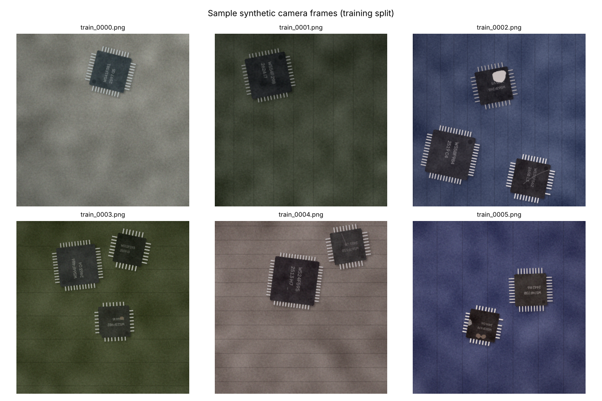

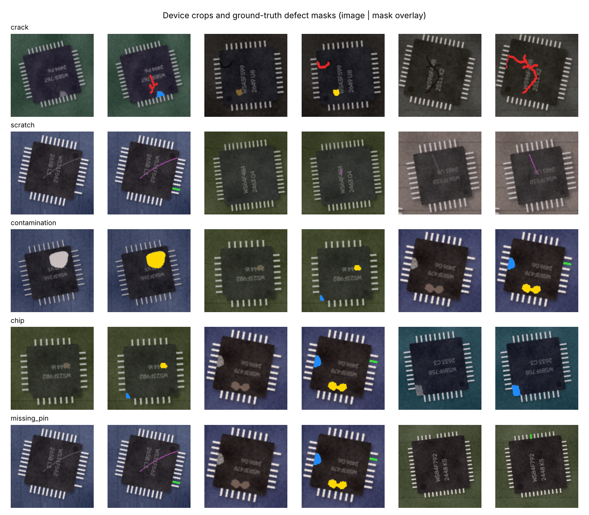

## 6. Exploratory Data Analysis

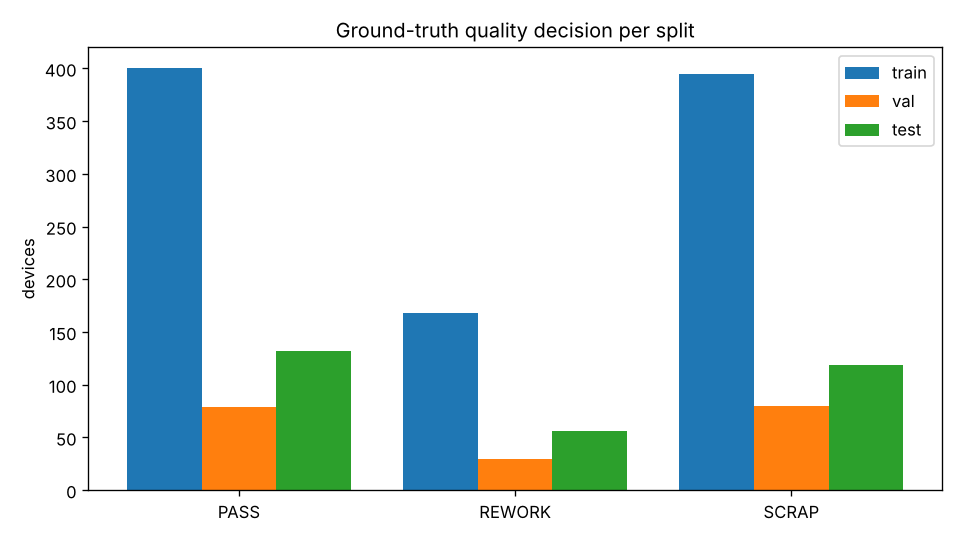

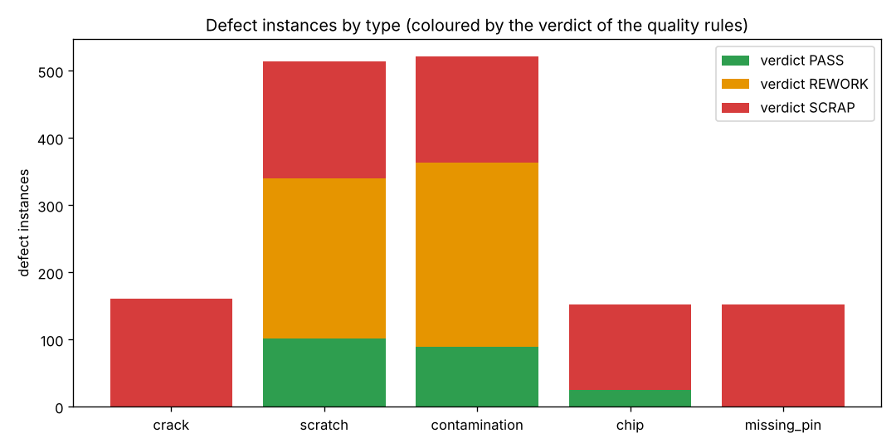

Defect sizes are spread across the rule thresholds (dashed lines), so every rule band is represented:

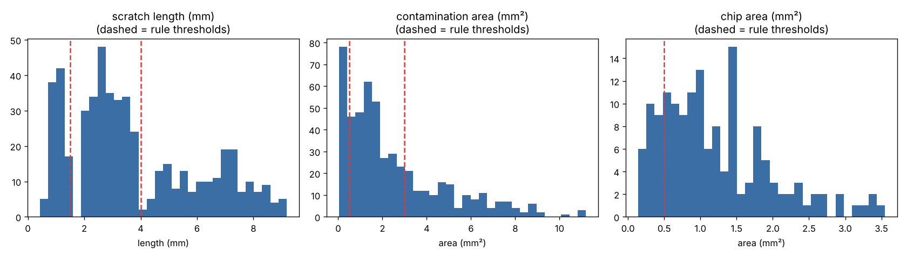

## 7. Methodology

### 7.1 Device detection — YOLO11n
Ultralytics YOLO11n (2.6 M parameters) initialised from COCO-pretrained weights and fine-tuned on the
frames (416 px input, 1 class `ic_device`). Default YOLO augmentation (mosaic, HSV, flips,
scale/translate).

### 7.2 Defect segmentation — YOLO11n-seg
YOLO11n-seg initialised from COCO-pretrained weights, trained on 256 × 256 device crops with polygon
labels for the 5 defect classes (instance segmentation: each defect gets its own mask, class and
confidence). Training crops are randomly shifted/scaled by a few percent to imitate detector box errors.

### 7.3 Defect segmentation — U-Net
A U-Net (4 down-sampling levels, base width 16, BatchNorm) written in PyTorch, predicting
a 6-class map (background + 5 defects). Loss: class-weighted cross-entropy + soft Dice (background is
~99 % of pixels). To make CPU training feasible it is trained on 128 × 128 patches (70 % centred on a
defect) and applied fully-convolutionally to the 256 × 256 crops; connected components of each class
become individual defects.

### 7.4 Measurement
For every defect mask: area = pixels × (camera px per crop px)² / (12 px/mm)²; length = long side of the
minimum-area rotated rectangle. Defects whose mask lies mostly outside the device box (a neighbouring
device inside the padded crop) are discarded.

### 7.5 Post-processing thresholds (tuned on the validation split)
Both segmenters use the same post-processing: a predicted defect is kept only if its confidence (YOLO
score, or mean U-Net class probability over the component) and its size (crop pixels) reach a
threshold. These two values were chosen per model by a grid search (confidence 0.1–0.9, minimum size
6–250 px) that maximises decision macro F1 on the **validation** split; the test split was used
only once, afterwards.

| Segmenter | Confidence ≥ | Min. size (px) | Val. macro F1 (tuned) | Val. macro F1 (default 0.2 / 6 px) |
|---|---|---|---|---|
| YOLO11n-seg | 0.1 | 6 | 0.847 | 0.828 |
| U-Net | 0.6 | 100 | 0.812 | 0.426 |

### 7.6 Quality rules (`configs/quality_rules.yaml`)

| Defect | Condition | Verdict | Reason |
|---|---|---|---|
| crack | any size | **SCRAP** | crack in package body |
| missing_pin | any size | **SCRAP** | missing lead |
| chip | area_mm2 < 0.5 | **PASS** | chip within cosmetic tolerance |
| chip | area_mm2 ≥ 0.5 | **SCRAP** | edge chipping too large |
| scratch | length_mm < 1.5 | **PASS** | scratch within cosmetic tolerance |
| scratch | 1.5 ≤ length_mm < 4 | **REWORK** | scratch - buff and re-mark |
| scratch | length_mm ≥ 4 | **SCRAP** | long scratch |
| contamination | area_mm2 < 0.5 | **PASS** | contamination within tolerance |
| contamination | 0.5 ≤ area_mm2 < 3 | **REWORK** | contamination - clean device |
| contamination | area_mm2 ≥ 3 | **SCRAP** | heavy contamination |

The device decision is the most severe verdict of its defects; a device with no defects passes.
The same rules applied to the exact ground-truth masks give the ground-truth decision.

## 8. Experimental Setup

| Item | Value |
|---|---|
| Hardware | CPU only (2 cores), no GPU |
| Frameworks | PyTorch, Ultralytics YOLO11, OpenCV, scikit-learn, FastAPI, Streamlit, SQLite |
| Seeds | dataset seed 42, training seed 42 |
| Model selection | best validation epoch (YOLO fitness / U-Net defect mIoU); test split untouched until evaluation |

| Model | Task | Epochs (run / max) | Best epoch | Training time | Best validation score |
|---|---|---|---|---|---|
| YOLO11n | device detection | 10 / 10 | 8 | 16.6 min | box mAP50-95 0.995 |
| YOLO11n-seg | defect segmentation | 25 / 25 | 23 | 38.4 min | mask mAP50 0.643 |
| U-Net (1,942,662 params) | defect segmentation | 30 / 30 | 29 | 29.3 min | defect mIoU 0.389 |

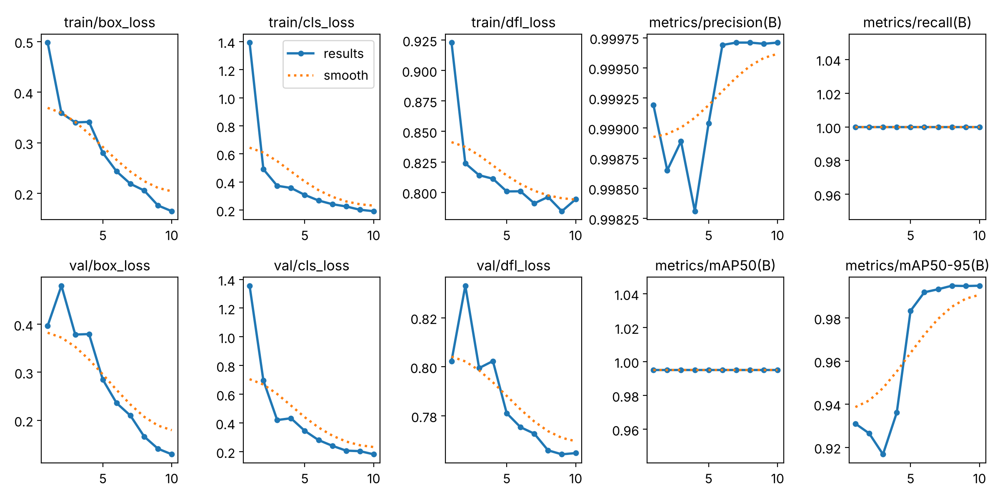

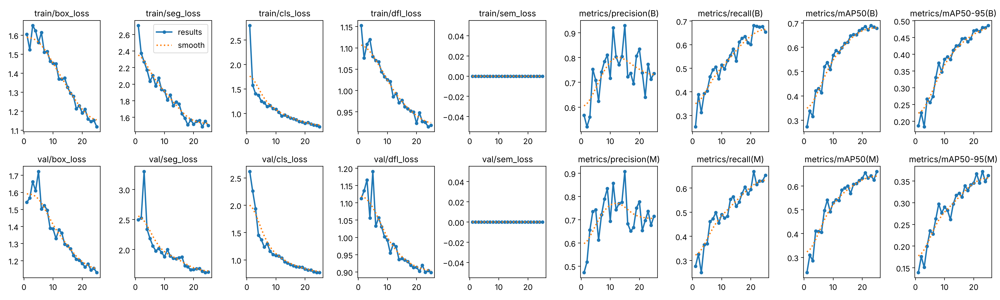

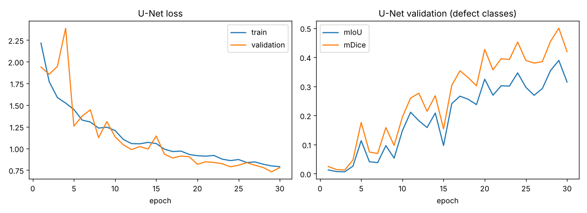

## 9. Results (held-out test split)

### 9.1 Device detection
YOLO11n on 150 test frames: precision **1.000**, recall **1.000**,
mAP50 **0.995**, mAP50-95 **0.995**.

### 9.2 Defect segmentation
YOLO11n-seg instance-segmentation metrics on the test crops: mask precision 0.742, recall 0.664, mask mAP50 **0.678**, mask mAP50-95 0.365.

| Defect | mask mAP50 | mask mAP50-95 |
|---|---|---|
| crack | 0.926 | 0.446 |
| scratch | 0.251 | 0.112 |
| contamination | 0.926 | 0.671 |
| chip | 0.941 | 0.489 |
| missing_pin | 0.348 | 0.109 |

Pixel-level IoU and Dice on all 307 test crops (same metric for both models):

| Defect | YOLO11n-seg IoU | YOLO11n-seg Dice | U-Net IoU | U-Net Dice |
|---|---|---|---|---|
| crack | 0.714 | 0.833 | 0.606 | 0.755 |
| scratch | 0.469 | 0.639 | 0.475 | 0.644 |
| contamination | 0.908 | 0.952 | 0.892 | 0.943 |
| chip | 0.795 | 0.886 | 0.367 | 0.537 |
| missing_pin | 0.166 | 0.285 | 0.092 | 0.168 |
| **mean** | **0.610** | **0.719** | **0.486** | **0.609** |

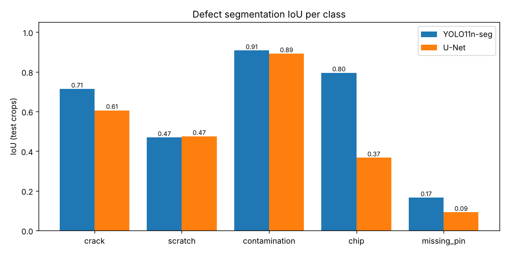

### 9.3 End-to-end quality decision
Every test frame is run through the complete pipeline; predicted devices are matched to ground-truth
devices (box IoU ≥ 0.5) and the predicted decision is compared with the ground-truth decision. A missed
device counts as an error.

| Pipeline (detector + segmenter) | Decision accuracy | Decision macro F1 | Scrap escapes (SCRAP→PASS) | False scrap (PASS→SCRAP) | Missed devices | Latency / frame (CPU) |
|---|---|---|---|---|---|---|
| YOLO11n + YOLO11n-seg | 0.886 | 0.877 | 5.0 % | 9.1 % | 0 / 307 | 100 ms |
| YOLO11n + U-Net | 0.827 | 0.818 | 9.2 % | 12.1 % | 0 / 307 | 221 ms |

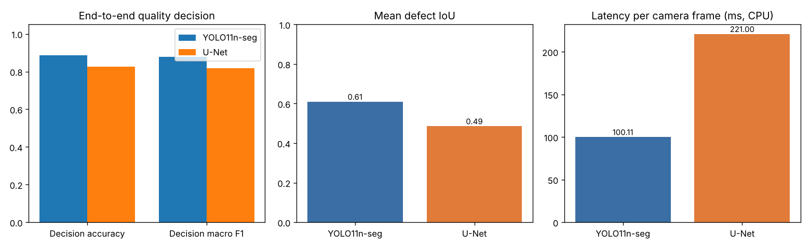

Confusion matrix of the selected pipeline (YOLO11n + YOLO11n-seg):

| True \ Predicted | PASS | REWORK | SCRAP | MISSED |
|---|---|---|---|---|
| **PASS** | 120 | 0 | 12 | 0 |
| **REWORK** | 4 | 46 | 6 | 0 |
| **SCRAP** | 6 | 7 | 106 | 0 |

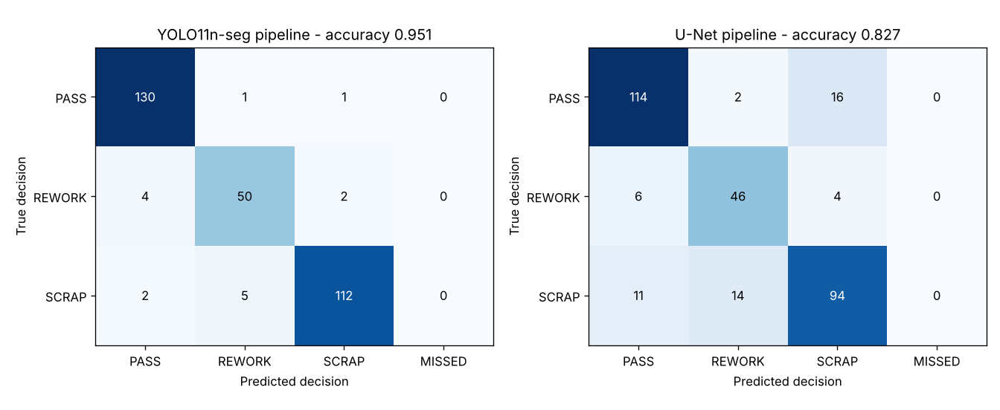

Per-decision results (YOLO11n-seg):

| Decision | Precision | Recall | F1 | Devices |
|---|---|---|---|---|
| PASS | 0.923 | 0.909 | 0.916 | 132 |
| REWORK | 0.868 | 0.821 | 0.844 | 56 |
| SCRAP | 0.855 | 0.891 | 0.872 | 119 |

### 9.4 Defect-type recognition
For each matched device: is every *significant* (non-PASS) defect type found?

| Significant defect type | Devices | YOLO11n-seg recall | YOLO11n-seg precision | U-Net recall | U-Net precision |
|---|---|---|---|---|---|
| crack | 27 | 0.963 | 0.963 | 0.963 | 0.703 |
| scratch | 75 | 0.707 | 1.000 | 0.827 | 1.000 |
| contamination | 82 | 1.000 | 0.953 | 1.000 | 0.976 |
| chip | 28 | 1.000 | 0.933 | 0.571 | 0.696 |
| missing_pin | 19 | 0.842 | 0.372 | 0.526 | 0.323 |

### 9.5 Example outputs

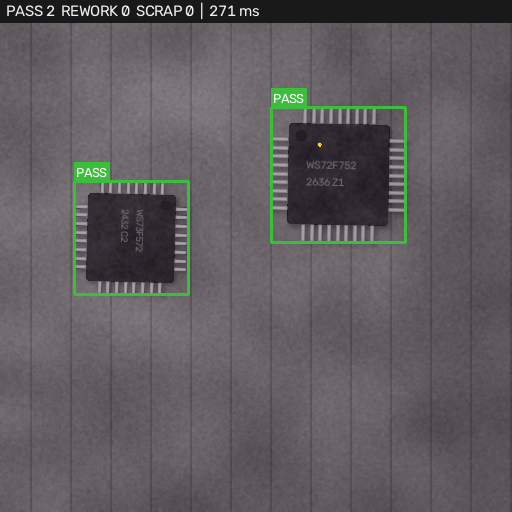
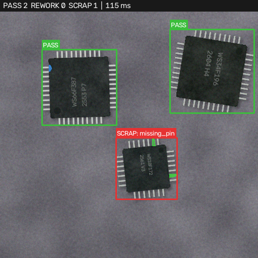

## 10. Model Comparison and Selection

Selection criterion: highest end-to-end decision macro F1 on the test split (ties: accuracy, then speed).
**Selected: YOLO11n + YOLO11n-seg.** YOLO11n-seg gives the highest end-to-end decision macro F1 (0.8775, accuracy 0.8860) vs U-Net (0.8178).

## 11. Application

| Component | What it does | How to run |
|---|---|---|
| CLI | inspect one image, print decisions, save annotated image, log to DB | `python run_project.py inspect img.png` |
| Camera / video | OpenCV loop over a webcam or video file, live overlay | `python run_project.py camera --source 0` |
| FastAPI | `/inspect`, `/history`, `/inspections/{id}`, `/stats`, `/rules`, `/health` | `python run_project.py api` |
| Streamlit | upload & inspect, conveyor simulation, analytics, rules | `python run_project.py dashboard` |
| SQLite | every inspection, device and defect | `results/inspections.db` |

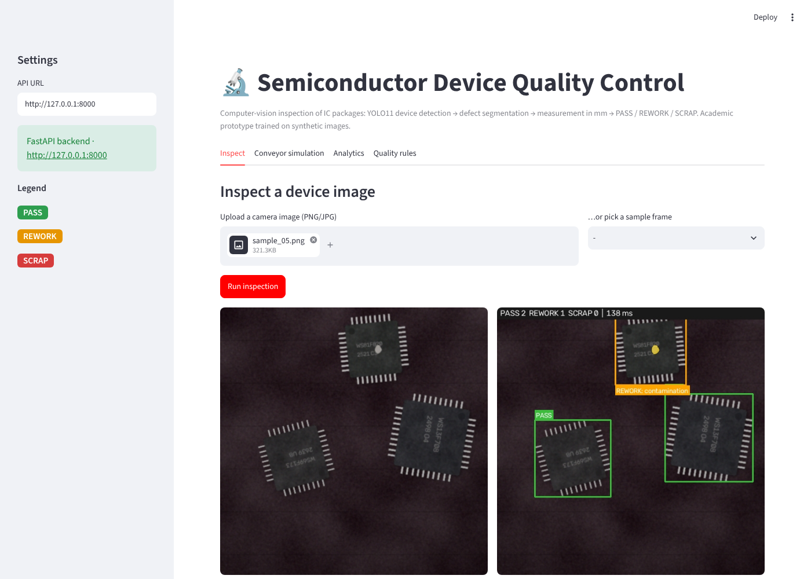

## 12. Discussion

- **Detection is essentially solved** on this data (mAP50 0.995): ICs are high-contrast,
  rigid objects. The difficulty of the task lies in the *defects*.
- **Hardest / easiest defect classes:** YOLO11n-seg: hardest missing_pin (IoU 0.166), easiest contamination (IoU 0.908), U-Net: hardest missing_pin (IoU 0.092), easiest contamination (IoU 0.892).
  Thin structures (scratches, cracks: 1–3 px wide) give low IoU even when correctly found, because a
  one-pixel offset already removes a large part of the overlap — the defect-type recall in 9.4 is the
  more meaningful measure for them.
- **Why YOLO11-seg wins:** it is pretrained (COCO) and predicts *instances* with a confidence each, so a
  defect is either reported whole or not at all. The U-Net predicts every pixel independently; without
  filtering, stray pixels form small fake "cracks" and "missing pins" that scrap good devices — the
  validation-tuned size/confidence filter (Section 7.5) removes most of them, but some real small defects
  are removed with them. The U-Net was also trained from scratch on a CPU budget and was still improving
  when training stopped (Section 8), so more training would narrow the gap.
- **Decision errors** of the selected pipeline: 12 × PASS predicted as SCRAP; 7 × SCRAP predicted as REWORK; 6 × SCRAP predicted as PASS; 6 × REWORK predicted as SCRAP; 4 × REWORK predicted as PASS. Most errors occur near a rule threshold
  (e.g. a scratch of ≈ 1.5 mm or ≈ 4 mm, contamination of ≈ 0.5 mm² or ≈ 3 mm²), where a small
  measurement error flips the verdict.
- **Safety-relevant metric:** the scrap-escape rate (a SCRAP device predicted as PASS) is
  5.0 %; the false-scrap rate (good device scrapped) is 9.1 %.
  In production the rule limits can be tightened to trade more false scrap for fewer escapes.

## 13. Limitations

- The images are synthetic. Real IC images have more varied lighting, reflections on leads, dust, real
  marking fonts and subtler defects; the models would need fine-tuning on real labelled images.
- One camera view (top). Bent leads, coplanarity and package warpage need side views or 3-D sensing.
- Measurements assume a calibrated, perpendicular camera (12 px/mm).
- CPU-only training with a limited number of epochs; a GPU would allow larger models and longer training.
- The prototype has not been validated on a real production line.

## 14. Future Work

- Fine-tune on a real dataset (e.g. MVTec AD, or images captured on the target line) using the same
  label formats.
- Add bent-lead and marking-quality (OCR) checks; add side cameras.
- Learn the PASS/REWORK/SCRAP decision from operator decisions instead of fixed rules.
- Export models to ONNX/TensorRT for edge deployment at line speed; PostgreSQL for multi-line data.

## 15. Conclusion

The project delivers a complete, working computer-vision quality-control system for semiconductor
devices: data generation with exact labels, a YOLO11 detector, two compared defect segmenters,
measurement in millimetres, configurable PASS/REWORK/SCRAP rules, and a usable application layer
(CLI, camera mode, FastAPI, Streamlit, SQLite). The selected pipeline (YOLO11n + YOLO11n-seg) makes the
correct quality decision for 88.6 % of the 307 unseen test devices.

## 16. References

1. Jocher, G., Qiu, J. *Ultralytics YOLO11*, 2024. https://github.com/ultralytics/ultralytics
2. Ronneberger, O., Fischer, P., Brox, T. "U-Net: Convolutional Networks for Biomedical Image
   Segmentation." MICCAI, 2015.
3. Redmon, J. et al. "You Only Look Once: Unified, Real-Time Object Detection." CVPR, 2016.
4. Bergmann, P. et al. "MVTec AD — A Comprehensive Real-World Dataset for Unsupervised Anomaly
   Detection." CVPR, 2019.
5. Paszke, A. et al. "PyTorch: An Imperative Style, High-Performance Deep Learning Library." NeurIPS, 2019.
6. FastAPI, Streamlit, OpenCV and SQLite documentation.

## 17. Use of Generative AI

Generative AI (Claude) assisted with designing the system, writing the code and synthetic data generator,
and drafting this report. All experiments were executed by the project code and every reported number
is inserted automatically from the generated result files. The team reviewed the code and results.
